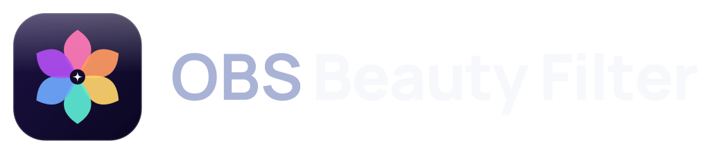
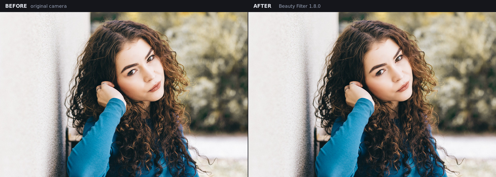
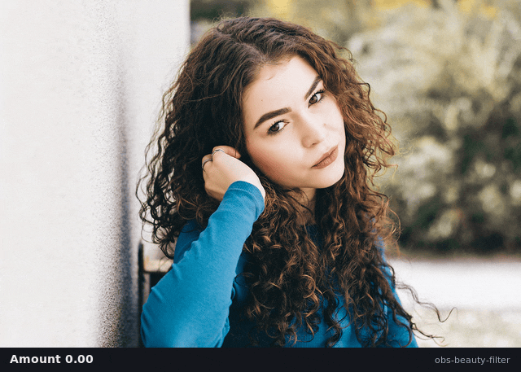
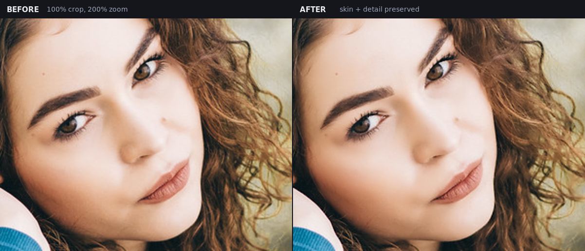
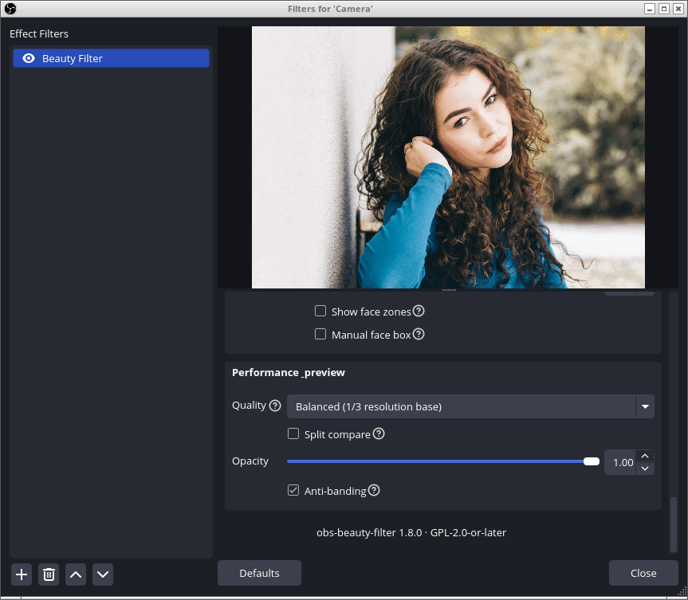

<p align="center">
  <picture>
    <source media="(prefers-color-scheme: dark)" srcset="assets/brand/png/logo-horizontal-dark.png">
    <source media="(prefers-color-scheme: light)" srcset="assets/brand/png/logo-horizontal-light.png">
    
  </picture>
</p>

**English** | [Tiếng Việt](README.md)

[](https://github.com/minhvuong097/obs-beauty-filter/actions/workflows/build.yml)
[](https://github.com/minhvuong097/obs-beauty-filter/releases/latest)

A GPU beauty filter for **OBS Studio** on Windows and Linux (macOS can be built from source but is not tested). Version **1.8.0** runs entirely on the GPU, plugs into the standard OBS filter pipeline, uses no AI model, never reads a full-resolution frame back to the CPU, and has no third-party runtime dependency.

Goal: natural-looking skin for livestreams/webcams **and high-resolution cameras** while preserving eyes, eyebrows, hair, pores and the face outline — with correct HDR handling.

## Demo



This is **real plugin output**, not a mock-up: a 1024×683 frame rendered through
headless libobs with Amount 0.62, Radius 9 px, Detail 0.40, Light balance 0.45,
Rosy 0.12 and Clarity 0.08.

<p align="center">
  
</p>

100% crop at 200% zoom — pores, eyebrows and hair survive, only the skin itself
gets flatter:



<p align="center">
  
</p>

The **?** icon next to each label is the tooltip with the full guidance (EN/VI).
The source photo is CC0 by jonas.svidras; credit, disclaimer and regeneration
steps are in [`assets/demo/README.md`](assets/demo/README.md).

## Features

- **Frequency separation for skin**: a low-resolution bilateral base (1/2–1/4 res, 25-tap Vogel disk) with full-resolution detail reconstruction — smooths broad skin blotches while keeping texture and reducing halos at 1440p/4K.
- **Edge-preserving skin smoothing**: 9/13/25-tap bilateral filter that softens pores and minor blemishes without erasing edges.
- **Layered skin mask**: YCbCr skin detection plus **neighbourhood coherence**, **gradient/texture rejection** (hair, wood grain) and **temporal stabilisation** to reduce flicker.
- **Heuristic face region**: estimates a face box from the largest connected skin component on a tiny 64×N grid, with temporal smoothing and a **manual face box** fallback. No ONNX/MediaPipe required.
- **Face prior**: an ellipse over the face and neck rejects most skin-coloured walls, furniture and clothing.
- **Teeth whitening**: brightens neutral, low-chroma, bright pixels inside the mouth ellipse.
- **Eye brightening**: lifts the sclera and gently raises the iris/pupil inside two eye ellipses.
- **Detail reconstruction**: retains luma texture (pores) more than chroma (blotches) and adds clarity outside skin.
- **Complexion controls**: exposure-like brightness, luma-preserving warmth, saturation and rosy tint, all skin-weighted.
- **Automatic light balance**: measures a 64 px readback (skin-weighted when a face is present) and lifts or lowers exposure toward a neutral level, with a soft highlight shoulder — no more blown highlights or crushed shadows, while skin stays even. Slider 0 = off, 0.35 = default, 1 = strong.
- **Soft glow** only on highlights, useful with ring lights and clean shadows.
- **Anti-banding**: triangular dithering for 8-bit output prevents banding in smooth skin gradients.
- **HDR-safe**: `GS_CS_709_EXTENDED`, `GS_CS_709_SCRGB` and `GS_CS_SRGB_16F` are processed in linear light; highlights above SDR white are preserved (no bypass, no clipping).
- **Previews**: skin mask, split view and face/eye/mouth zones.
- **Built-in starting presets**: Natural, Cinema, Studio, Soft, Beard, Dark skin, HDR and Default. Pick one, then fine-tune; any manual change marks the selection as **Custom**.
- **Custom presets**: save, overwrite, reload and delete your own looks. They are stored as `custom-presets.json` in the OBS module config directory and survive scene-collection changes and restarts.
- **Reset button**: return every control to the Default preset without removing the filter.
- **Safe failure**: if the effect or a GPU texture cannot be created, the properties page shows an error and the source passes through unchanged instead of rendering black.
- **Three performance levels**: Fast / Balanced / High.
- **Alpha support**, SDR 8-bit and SDR 16-bit.
- **Bilingual UI**: English and Vietnamese.
- **Full tooltips**: short labels keep the controls aligned, and the one-line guidance for every control appears in a tooltip (the **?** icon).
- **Asynchronous readback**: the 64 px analysis grid is mapped on the next frame, so it never blocks the render pass; heavy scenes no longer stutter while the CPU waits for the GPU.
- **Version inside OBS**: the log and the bottom of the properties page name the exact build, which makes bug reports unambiguous.

## Project layout

```
obs-beauty-filter/
├── CMakeLists.txt
├── CHANGELOG.md
├── CONTRIBUTING.md          # build/test/style/release conventions
├── SECURITY.md              # vulnerability reports and checksum verification
├── src/
│   ├── beauty-filter.c      # OBS filter + properties + multi-pass renderer
│   ├── beauty-filter.h
│   ├── beauty-custom-presets.c # user preset JSON persistence
│   ├── beauty-custom-presets.h
│   ├── beauty-presets.c     # built-in starting presets
│   ├── beauty-presets.h
│   ├── beauty-settings.h    # shared obs_data setting names
│   ├── face-region.c        # heuristic face-box estimation (CPU, tiny grid)
│   ├── face-region.h
│   └── plugin-main.c        # module entry point
├── data/
│   ├── beauty_filter.effect # OBS effect: MaskPass / MaskAnalysis / BlurBase / Draw*
│   └── locale/
│       ├── en-US.ini
│       └── vi-VN.ini
├── tests/
│   ├── load-test.c          # load + render + mask/face/light/HDR integration test
│   ├── render-matrix-test.c # 8 presets x 4 resolutions + 16F golden test
│   ├── preset-test.c        # built-in/custom preset unit test
│   ├── face-region-test.c   # face-detector unit test
│   └── golden/
│       └── render-matrix.txt # sampled golden image used by Linux CI
├── docs/
│   ├── ARCHITECTURE.md      # + ARCHITECTURE.en.md
│   ├── TUNING.md            # + TUNING.en.md
│   ├── TESTING.md           # + TESTING.en.md
│   └── COMPATIBILITY.md     # + COMPATIBILITY.en.md
├── installer/
│   └── obs-beauty-filter.iss # Inno Setup source for the Windows installer
├── assets/
│   ├── brand/                # logo, icon, lockups, banner
│   └── demo/                 # README stills/GIF, CC0 source, credit
├── tools/
│   ├── brand/gen.py          # regenerates the brand kit
│   └── demo/                 # offline renderer + build-assets.sh
└── scripts/
    ├── build-linux.sh
    └── build-windows.ps1
```

## Windows installation

### Option A — installer `.exe` (recommended)

Download `obs-beauty-filter-1.8.0-windows-x64-setup.exe` from
**[GitHub Releases](https://github.com/minhvuong097/obs-beauty-filter/releases/latest)**
and run it. The installer:

1. Detects the OBS Studio 33+ installation from the Windows registry.
2. Asks OBS to close if it is running, so the DLL can be replaced safely.
3. Installs `obs-beauty-filter.dll` and `data\` into
   `C:\ProgramData\obs-studio\plugins\obs-beauty-filter\` — the OBS 33+
   third-party plugin layout — and registers **OBS Beauty Filter** in
   **Apps & Features** with an uninstaller.
4. Offers to launch OBS when setup finishes. Add **Beauty Filter** to a source
   via **Filters** → **+**.

For a **portable OBS** tree, setup looks for `portable_mode`,
`portable_mode.txt`, `obs_portable_mode` or `obs_portable_mode.txt` and installs
into `<OBS-portable-root>\plugins\obs-beauty-filter\` instead. If the portable
copy is not detected, run the installer with `/OBSDIR=<OBS-portable-root>` or
pick `<OBS-portable-root>\plugins\obs-beauty-filter` on the destination page.

> The `.exe` installer requires **OBS Studio 33 or newer**. On OBS 32 and older
> it stops with an explanatory message; use the ZIP below with the legacy
> layout. The plugin is not code-signed, so Windows SmartScreen may show
> "Windows protected your PC" — choose **More info** → **Run anyway** after
> verifying the SHA-256 checksum from the release.

Uninstall it from **Settings → Apps → Installed apps** (or
**Add or remove programs**). Uninstalling removes the plugin files and leaves
your OBS scenes, profiles and custom presets untouched.

### Option B — prebuilt ZIP (manual install)

- Windows x64: `obs-beauty-filter-1.8.0-windows-x64.zip`
- Linux x86_64: `obs-beauty-filter-linux-x86_64.tar.gz`
- Each release includes `SHA256SUMS.txt` so you can verify the download.

**OBS Studio 33+ — new layout:**

1. Close OBS Studio.
2. Create this directory:
   `C:\ProgramData\obs-studio\plugins\obs-beauty-filter\`
3. Copy `obs-beauty-filter.dll` into it.
4. Copy the whole `data` directory into:
   `C:\ProgramData\obs-studio\plugins\obs-beauty-filter\data\`
   You should end up with:
   - `...\obs-beauty-filter\obs-beauty-filter.dll`
   - `...\obs-beauty-filter\data\beauty_filter.effect`
   - `...\obs-beauty-filter\data\locale\en-US.ini`
5. Open OBS → select the camera source → **Filters** → **+** → **Beauty Filter**.

> `%ProgramData%` is usually hidden. For portable OBS, use
> `<OBS-portable-root>\plugins\obs-beauty-filter\` instead of
> `C:\ProgramData\obs-studio\plugins\obs-beauty-filter\`.

**OBS 32 and older — legacy layout:**

1. Copy `obs-beauty-filter.dll` to:
   `C:\Program Files\obs-studio\obs-plugins\64bit\`
2. Copy the contents of `data` to:
   `C:\Program Files\obs-studio\data\obs-plugins\obs-beauty-filter\`

> OBS 33 still loads the legacy layout but flags it as **Legacy** in Plugin
> Manager; OBS 34 will stop loading it. Prefer the new layout above.
>
> If OBS 33 starts in **Safe Mode**, third-party plugins are not loaded. Leave
> Safe Mode and restart OBS.

### Option C — build from source (recommended for development)

**In-tree build** (easiest if you already build OBS from source):

```powershell
# Copy this directory to obs-studio/plugins/obs-beauty-filter
# Add this line to obs-studio/plugins/CMakeLists.txt:
#   add_core_module(obs-beauty-filter)
```

Then build OBS as usual (CMake preset + Visual Studio 2026, or the toolchain
required by your OBS 33 build). The plugin and data are copied into the OBS
build tree using OBS' core-module layout. This is for local development only:
in OBS 33 the `core` directory is reserved for official plugins. Release builds
for users should use the standalone build and install into the `plugins`
directory.

**Standalone build** (requires an OBS SDK/build tree that provides `libobsConfig.cmake`):

```powershell
cmake -S . -B build -G "Visual Studio 18 2026" -A x64 `
  -DCMAKE_PREFIX_PATH="C:\obs-studio\build_x64;C:\obs-deps\x64"
cmake --build build --config RelWithDebInfo
cmake --install build --config RelWithDebInfo `
  --prefix "$env:ProgramData\obs-studio\plugins"
```

If you use Visual Studio 2022, replace the generator with
`"Visual Studio 17 2022"`. With the new layout, `--prefix` must point to the
**plugins directory**, not the OBS install root:

- Normal OBS: `%ProgramData%\obs-studio\plugins`
- Portable OBS: `<OBS-portable-root>\plugins`

To package for the old layout (OBS 32 and older), add
`-DBEAUTY_OBS33_PLUGIN_LAYOUT=OFF` and use the prefix `C:\Program Files\obs-studio`.

Or use the script:

```powershell
# Build + install into the OBS 33+ layout
.\scripts\build-windows.ps1 -ObsBuild "C:\obs-studio\build_x64" `
  -ObsSdk "C:\obs-deps\x64" `
  -InstallPrefix "$env:ProgramData\obs-studio\plugins"

# Build + create a distribution zip (zip root is obs-beauty-filter\)
.\scripts\build-windows.ps1 -ObsBuild "C:\obs-studio\build_x64" `
  -ObsSdk "C:\obs-deps\x64" -Package

# Legacy layout for OBS 32 and older
.\scripts\build-windows.ps1 -Layout legacy `
  -InstallPrefix "C:\Program Files\obs-studio"
```

> The script automatically picks the Visual Studio 2026 generator when both
> CMake and a local VS 2026 installation are available; otherwise it falls back
> to Visual Studio 2022. The zip is written to `dist\`; extract it into the
> matching `plugins` directory above (or the portable OBS `...\plugins\`
> directory).

To build both the ZIP and the `.exe` installer in one step, install
[Inno Setup 6](https://jrsoftware.org/isinfo.php) (the script can install it
through Chocolatey) and add `-Installer`:

```powershell
.\scripts\build-windows.ps1 -ObsBuild "C:\obs-studio\build_x64" `
  -ObsSdk "C:\obs-deps\x64" -Package -Installer
```

Both files are written to `dist\`. See `installer/obs-beauty-filter.iss` for
the OBS detection, portable-mode and uninstall rules.

> If you only have an installed OBS without the OBS SDK/source, use the
> prebuilt installer or ZIP from Options A/B. Building requires OBS source
> (in-tree) or an OBS SDK/CMake package (standalone).

### Linux

```bash
sudo apt install cmake build-essential libobs-dev   # or the equivalent package
cmake -S . -B build -DCMAKE_BUILD_TYPE=Release -DCMAKE_INSTALL_PREFIX=/usr
cmake --build build -j"$(nproc)"
sudo cmake --install build
```

- **Debian/Ubuntu:** add `-DCMAKE_INSTALL_LIBDIR="lib/$(dpkg-architecture -qDEB_HOST_MULTIARCH)"`
  so the plugin lands in `/usr/lib/<triplet>/obs-plugins`.
- **Fedora/Arch:** check OBS' `obs-plugins` directory and set `CMAKE_INSTALL_LIBDIR`
  accordingly if needed.
- Avoid the default `/usr/local` prefix unless your OBS searches that path.

Alternatively run `./scripts/build-linux.sh` then `sudo cmake --install build` (default prefix `/usr`;
set `INSTALL_LIBDIR=...` for Debian/Ubuntu multiarch).

## Quick start

1. Add **Beauty Filter** to the camera source (or to a scene containing the camera).
2. Pick a **Starting preset** that matches your camera (`Natural` for a 1080p webcam, `Cinema` for 1440p/4K, `Studio` for close-ups), or start from the defaults:
   - **Amount** `0.35`
   - **Radius** `6`
   - **Detail preservation** `0.35`
   - **Skin detection** on, **Skin sensitivity** `0.50`
   - **Face-aware zones** on, **Temporal mask stability** `0.60`
   - **Rosy tint** `0.15`
   - **Auto light balance** `0.35`
   - **Teeth whitening / Eye brightening** `0` (enable when needed)
3. When the look is right, type a name under **Preset name** and press **Save preset**; it appears in the dropdown as `Custom: <name>`. **Reset to defaults** returns everything to Default.
4. Enable **Show skin mask** to inspect the skin mask. If skin-coloured walls/wood also turn white, keep **Face-aware zones** on and lower **Skin sensitivity**.
5. Enable **Show face zones** to inspect the face box, eyes and mouth. If the box is wrong, enable **Manual face box** and adjust `Face center X/Y`, `Face width/height`.
6. Raise **Teeth whitening** to `0.2–0.5` and **Eye brightening** to `0.1–0.3`. If surrounding skin brightens too, reduce these values.
7. Enable **Split preview** to compare the left half (original) with the right half (processed), then turn it off.
8. If skin looks flat, raise **Detail preservation**, lower **Amount** or **Radius**.
9. If the mask flickers during head motion, raise **Temporal mask stability** (`0.6–0.75`). If you see ghosting, lower it to `0.3–0.5`.

## Parameters

| Parameter | Default | Range | Meaning |
|---|---:|---:|---|
| Amount | 0.35 | 0–1 | Skin smoothing strength |
| Radius (px @1080p) | 6 | 0–24 | Sampling radius, scaled by frame height |
| Detail preservation | 0.35 | 0–1 | Retains skin texture/detail |
| Skin detection | On | On/Off | Process skin only |
| Skin sensitivity | 0.50 | 0–1 | Widens/tightens the skin mask |
| Show skin mask | Off | On/Off | White/black mask preview for tuning |
| Brightness | 0 | -50..50 | Skin brightness (mask-weighted) |
| Warmth | 0 | -50..50 | Warm/cool skin tint |
| Saturation | 0 | -50..50 | Skin colour saturation |
| Rosy tint | 0.15 | 0–1 | Natural rosy tint |
| Clarity | 0.10 | 0–1 | Sharpens non-skin areas |
| Soft glow | 0.05 | 0–1 | Soft skin glow |
| Auto light balance | 0.35 | 0–1 | Lifts/lowers exposure from measured scene brightness; 0 = off, 1 = strongest |
| Face-aware zones | On | On/Off | Enables face prior + teeth/eye zones |
| Temporal mask stability | 0.60 | 0–1 | Blends mask with history; higher = more stable, less flicker |
| Teeth whitening | 0 | 0–1 | Whitens teeth inside the mouth zone |
| Eye brightening | 0 | 0–1 | Brightens eyes inside the eye zones |
| Show face zones | Off | On/Off | Shows face prior (green), eyes (blue), mouth (yellow) |
| Manual face box | Off | On/Off | Use the manual box instead of auto detection |
| Face center X / Y | 0.50 / 0.45 | 0–1 | Face centre in normalised coordinates |
| Face width / height | 0.32 / 0.42 | 0.05–1 | **Full** face-box size, normalised |
| Quality | Balanced | Fast/Balanced/High | 1/4, 1/3 or 1/2 resolution base; High recommended for 1440p/4K |
| Anti-banding | On | On/Off | Triangular dither for 8-bit output |
| Split preview | Off | On/Off | Left = original, right = processed |
| Overall opacity | 1.0 | 0–1 | Global mix with the original frame |

Note: `Face width/height` are full dimensions, not half-extents. For example a face covering 32% of the frame width and 42% of its height.

### Situation-based suggestions

- **1080p webcam, indoor lighting**: Amount `0.35–0.5`, Radius `5–8`, Detail `0.3–0.5`, Clarity `0.05–0.15`.
- **High-end 1440p/4K camera**: Quality `High`, Amount `0.20–0.35`, Radius `6–12`, Detail `0.45–0.65`, Clarity `0.05–0.10`, Skin sensitivity `0.45–0.55`. The base pass keeps full-resolution detail, so skin looks smooth rather than flat.
- **Close-up / blemished skin**: Amount `0.55–0.7`, Radius `8–12`, Detail `0.25`, Quality `High`, Teeth `0.3–0.5`, Eyes `0.2–0.4`.
- **Men / beards**: Amount `0.2–0.3`, Detail `0.5–0.7`, Radius `4–6`, Clarity `0.1`; lower Teeth/Eyes.
- **Deep skin tones**: Sensitivity `0.6–0.75`, Amount `0.25–0.4`; always verify with **Show skin mask**.
- **Low light / noise**: Beauty Filter does not denoise. Add **Denoise** before it, then Amount `0.2–0.35`, Glow `0.1`.
- **4K / many stacked filters**: Quality `High` on a discrete GPU with headroom; if frame rate drops, move to `Balanced` (1/3 base) before `Fast`. Radius scales automatically with resolution.
- **HDR source (Rec.709 extended / scRGB / 16F)**: use the same controls; the filter processes linear light and preserves highlights. Re-check Amount/Glow because HDR has a wider brightness range.

See also [docs/TUNING.en.md](docs/TUNING.en.md).

## Technical architecture

```
Camera frame (SDR 8-bit / SDR 16F / Rec.709 extended / scRGB)
   │
   ▼
[Custom capture]
   │  gs_texrender_begin_with_color_space(output_space)
   ▼
Source texture
   │
   ├─► MaskPass (half-res RGBA8, ping-pong)
   │      ├─ YCbCr skin probability
   │      ├─ neighbourhood coherence (8 samples)
   │      ├─ gradient/texture guard
   │      ├─ temporal blend with history
   │      └─ face prior (face + neck ellipse)
   │      Output: R = raw mask, G = stabilised mask
   │
   ├─► MaskAnalysis (64×N)  ──► small CPU readback, mapped next frame (every 6 frames)
   │                              └─► face-region.c: connected component
   │                                  + upper band → face box
   │
   ├─► BlurBase (1/2–1/4 res, RGBA16F)
   │      └─ 25-tap Vogel disk bilateral → low-frequency base
   │
   └─► DrawFast / DrawBalanced / DrawHigh
          ├─ frequency separation: base + reconstructed detail
          ├─ detail reconstruction + clarity
          ├─ complexion + glow (HDR-safe)
          ├─ teeth/eye zones (only with a valid face box)
          ├─ anti-banding dither
          ├─ opacity / split / previews
          └─ HDR scale restore
   │
   ▼
Output (alpha preserved, values > SDR white preserved on HDR)
```

- **No longer a single pass**: the mask pass runs at half resolution, the analysis pass at 64×N, the base pass at 1/2–1/4 resolution, and the main pass at full resolution.
- **Frequency separation**: the base pass blurs broad skin areas at reduced resolution with a 25-tap Vogel disk; the final pass restores full-resolution detail, weighting luma more than chroma. This preserves pores, reduces halos and avoids sparse kernels at 1440p/4K.
- **No full-frame readback**: only the 64×N grid (at most 64×64 RGBA = 16 KB) is read back once every 6 frames and mapped on the following frame so it never stalls the GPU; it runs only when the face box or **Auto light balance** needs it.
- **Ping-pong mask textures** provide history for temporal stabilisation without per-frame allocation.
- **The base is RGBA16F** even for SDR, avoiding linear 8-bit quantisation in shadows before the sRGB encode.
- Radius is normalised to frame height (1080p reference), so one preset behaves similarly at 720p/1080p/4K.
- **HDR**: `GS_CS_709_EXTENDED` and `GS_CS_SRGB_16F` use `hdr_scale = 1.0`; `GS_CS_709_SCRGB` uses `80 / obs_get_video_sdr_white_level()`. The frame is captured directly in the **output space** so OBS performs any source conversion/tonemapping; the shader brings samples into SDR-relative linear exactly once, does not `saturate` HDR output, and divides by the scale before writing.
- Maths and design rationale: [docs/ARCHITECTURE.en.md](docs/ARCHITECTURE.en.md).

## Performance

The dominant cost is the full-resolution fragment shader, plus a half-resolution mask pass, a 1/2–1/4-resolution base pass (25 taps) and a tiny readback:

| Quality | Base | Notes |
|---|---|---|
| Fast | 1/4 res | iGPU, 4K, or several stacked filters |
| Balanced | 1/3 res | Default for 1080p60 |
| High | 1/2 res | Close-ups, discrete GPU, 1440p/4K — recommended for high-end cameras |

- `MaskPass` runs at half resolution with 8 coherence + 4 gradient samples; much cheaper than full resolution.
- `MaskAnalysis` runs only every 6 frames when automatic face-aware detection or automatic light balance is on, and its staging copy is mapped on the next frame, so it never stalls the render pass.
- `BlurBase` is always cheaper than a full-resolution bilateral at the same radius because it touches 1/4–1/16 of the pixels.
- Disable **Face-aware zones** when you do not use teeth/eye controls to skip the mask pass when `Skin detection` is also off.
- If frame rate drops: lower Quality first, then Radius, then disable Glow.

## Known limitations

- **Face detection is heuristic**, not ML landmark/segmentation. It finds the largest skin component and derives the face from its upper band; it can fail with multiple people, occluded faces, hats, strong lighting or skin-coloured backgrounds. Use **Show face zones** and **Manual face box**.
- **Teeth/eye zones are estimated ellipses**, not per-tooth/per-eyelid landmarks. Best results with a front-facing face that fills a good part of the frame.
- The skin mask is still colour-based; coherence + face prior reduce but do not eliminate skin-coloured wood/walls/clothing.
- No noise reduction.
- HDR is processed but not tone-mapped; the filter preserves the source dynamic range.
- Results depend on skin tone and lighting; test with multiple skin tones before production use.
- Windows CI exercises the D3D11 path on every commit, but real GPU/driver combinations still vary; confirm rendering and HDR on the target machine before production use.

## Roadmap

1. Compute shader (D3D11/OpenGL) for large radii at 4K.
2. Optional lightweight ML landmarks/segmentation (ONNX/MediaPipe) for multi-face and occlusion.
3. Landmark-driven automatic face boxes instead of the upper-band heuristic.
4. Optional GPU timing diagnostics that avoid the synchronous timer reads used by `gs_timer`.

### Not planned (requires a paid service)

The project uses free services only: GitHub Actions, Alpine/Windows runners and
GitHub Releases. These items are **not** planned because they need a paid
subscription:

- **Authenticode signing for the Windows installer** — needs a yearly
  code-signing certificate. Releases ship `SHA256SUMS.txt` instead, built by
  public CI, with verification steps in [SECURITY.md](SECURITY.md).
- **macOS notarization** — needs a paid Apple Developer Program membership.
  macOS can still be built from source; downloaded builds trigger a Gatekeeper
  warning.
- **Cloud ML inference** — a local ONNX/MediaPipe model stays free and remains
  on the roadmap; a per-request paid service does not.

## Testing

```bash
cmake -S . -B build -DCMAKE_BUILD_TYPE=RelWithDebInfo -DBEAUTY_BUILD_TESTS=ON
cmake --build build -j"$(nproc)"

# Face-detector, preset and render-matrix tests
./build/beauty-face-region-test
./build/beauty-preset-test
xvfb-run -a ./build/beauty-render-matrix-test \
  ./build/obs-beauty-filter.so \
  ./build/rundir/share/obs/obs-plugins/obs-beauty-filter

# Load + render + mask/face/light/HDR integration test
xvfb-run -a ./build/beauty-load-test \
  ./build/obs-beauty-filter.so \
  ./build/rundir/share/obs/obs-plugins/obs-beauty-filter \
  /usr/lib/obs-plugins/image-source.so \
  /usr/share/obs/obs-plugins/image-source

# Full suite under ASan/UBSan (Clang on musl/Alpine)
cmake -S . -B build-sanitize -DCMAKE_BUILD_TYPE=Debug \
  -DBEAUTY_BUILD_TESTS=ON -DBEAUTY_SANITIZE=address,undefined
cmake --build build-sanitize -j"$(nproc)"
```

Expected final lines:

```text
OK: built-in and custom presets, lookup, apply, defaults and NULL handling verified
OK: render matrix verified 4 resolutions x 8 presets, opaque alpha, 16F range and finite output
OK: module loaded, filter created, effect compiled, filter rendered, mask/opacity/face zones/texture/light balance/HDR verified
```

The integration test covers: default filter output, skin mask, opacity 0, teeth/eye zones (with a manual face box), zone preview colours, frequency separation on a textured skin pattern (contrast drops at low Detail and returns at high Detail), automatic light balance (a bright frame is pulled down after the readback tick), Rec.709 extended HDR and scRGB HDR (values above 1.0 are preserved, actually processed, and not double-scaled). It also checks that the preset/save/delete/reset property controls exist. The render matrix runs all 8 presets at 360p, 720p, 1080p and 1440p (opt-in 4K), verifies opaque alpha and finite 16F output, and compares a sampled golden image on Linux. See [docs/TESTING.en.md](docs/TESTING.en.md) for the full test matrix and the i5-1235U benchmark guide.

> **Test status:** GitHub Actions builds and tests on both platforms. Linux (Alpine 3.21, OBS 30.2.3, OpenGL/Mesa llvmpipe) runs the full `beauty-face-region-test`, `beauty-preset-test`, `beauty-render-matrix-test` (with golden image) and `beauty-load-test` suite, then repeats the suite under ASan/UBSan. Windows x64 builds directly against OBS 33.0.1 source plus `obs-deps`, runs the same tests on the real D3D11 path (matrix invariants, module load + effect compilation), packages the new plugin layout, builds the `.exe` installer and silently installs/uninstalls it in a smoke test. A manual in-OBS render/HDR check on real hardware is still recommended; see [docs/TESTING.en.md](docs/TESTING.en.md) and the [compatibility matrix](docs/COMPATIBILITY.en.md).

## Changelog and compatibility

See [CHANGELOG.md](CHANGELOG.md) for release notes and
[docs/COMPATIBILITY.en.md](docs/COMPATIBILITY.en.md) for the tested OBS,
platform and colour-space matrix.

## Brand assets

The six-petal aperture mark and the full product name on one line live in
[`assets/brand`](assets/brand), together with a short usage guide
([`assets/brand/README.md`](assets/brand/README.md)) covering colours, layout,
clearspace, minimum sizes and the mono/dark/light variants. The brand assets are
not covered by the GPL — see that guide before reusing them.

## License

GPL-2.0-or-later. See [LICENSE](LICENSE).

This is an independent project and is not part of the OBS Project. OBS Studio is software by the OBS Project and its contributors.
